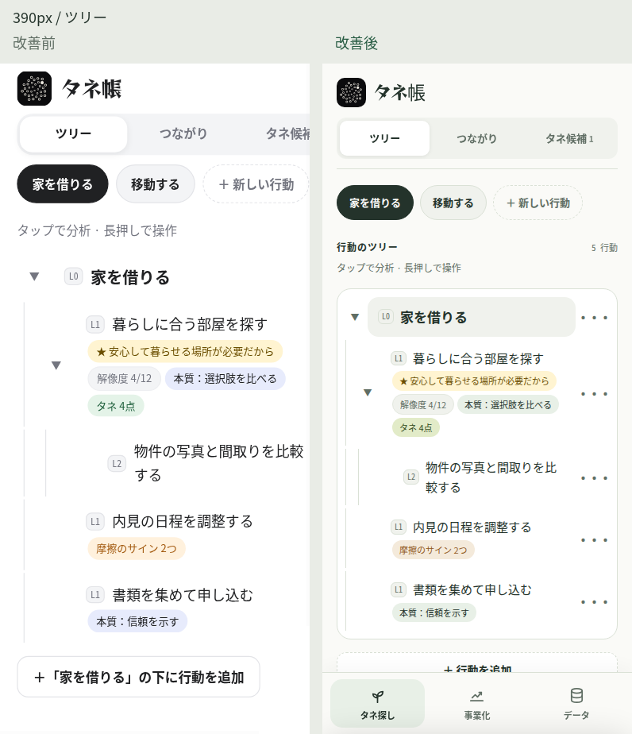
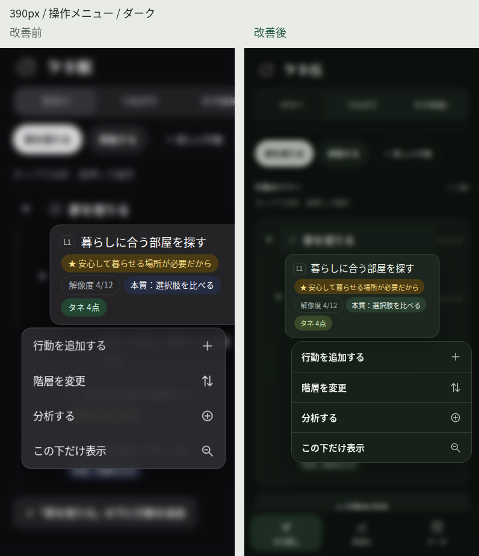
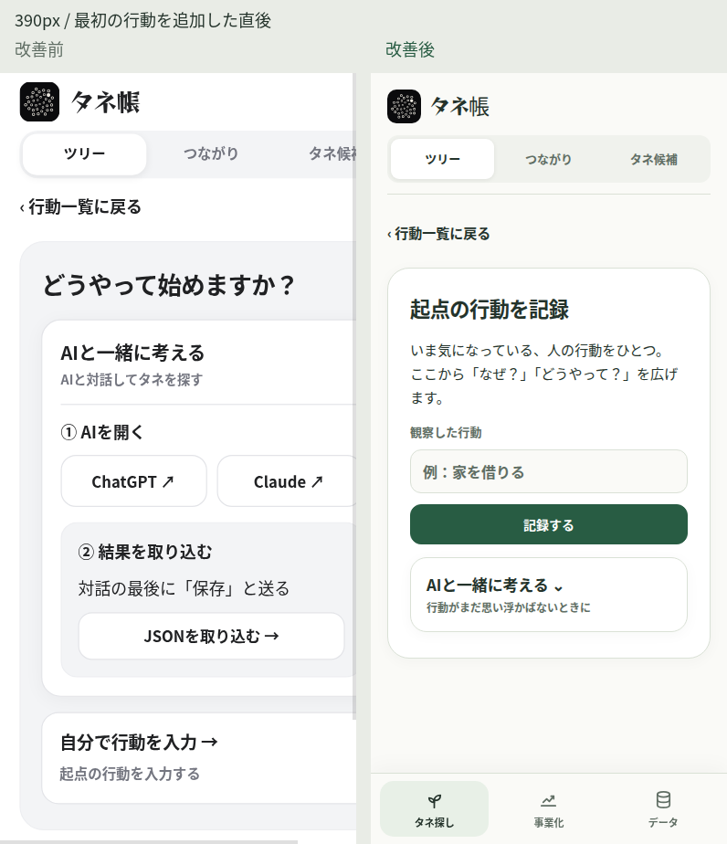
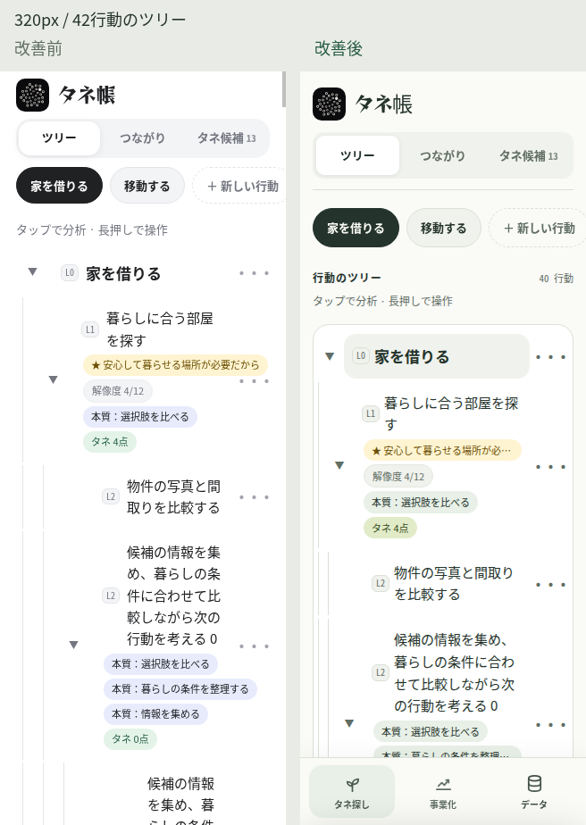
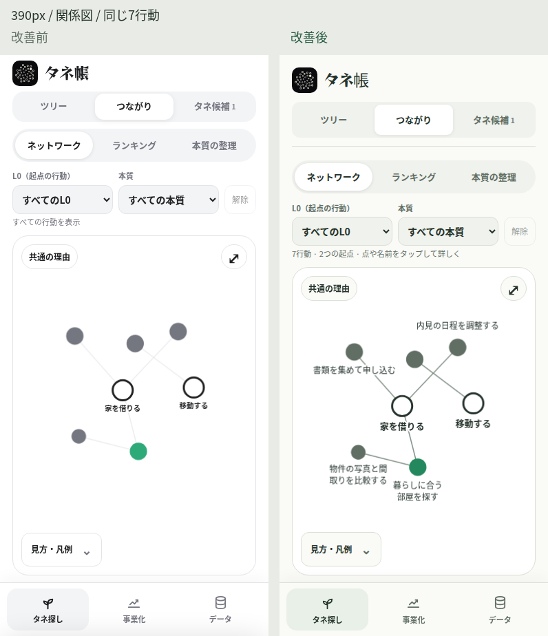
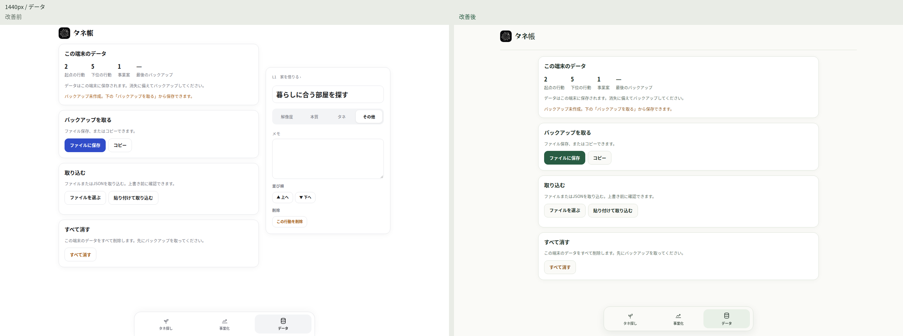
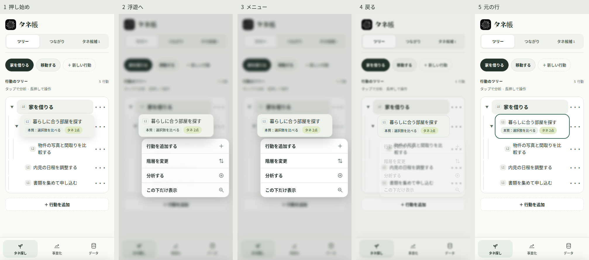
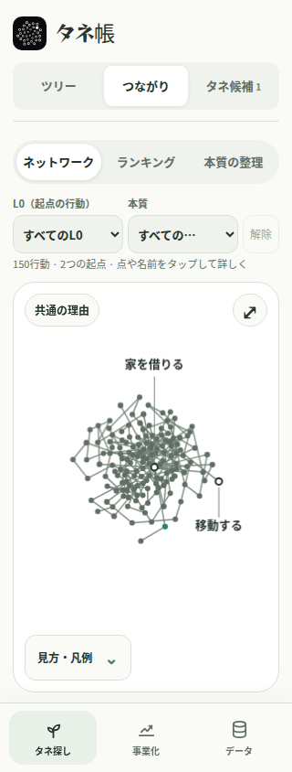
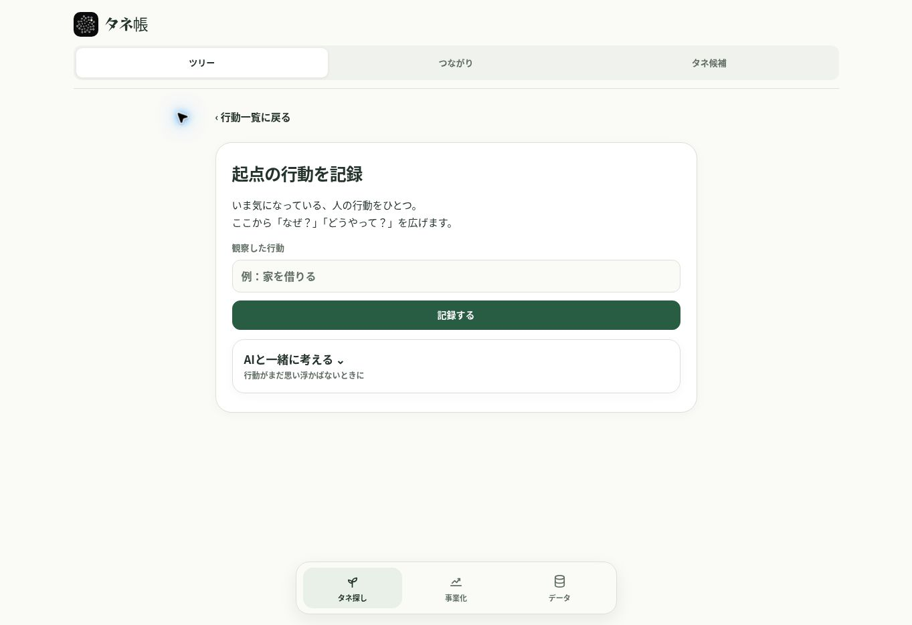

# 市場のタネ帳 — UI/UX改善と検証記録

公開PWA: https://yrbonington.github.io/tane/  
作業日: 2026-10-11 / 作業ブランチ: `main` / PRなし  
改善前: `429845bdd3c91526e505a6f5b30760cb9bc6550d`  
改善後のアプリコード: `935d0cd2d0b00a89de92b477632c8fea9e32bc9f` / PWAキャッシュ: `tane-v72`

実装、公開版の操作、ブラウザ回帰テスト、スクリーンショットの目視を繰り返して改善した。既存のデータ形式と機能を維持した。ユーザーの保存済みデータを削除・初期化していない。

自己評価は **64 → 90 / 100**。90点は、検証したChrome環境での暫定評価であり、アワードの審査結果や全端末での品質保証を意味しない。iPhone実機・ホーム画面PWA・VoiceOverは未検証なので、全環境で完成したとは判定していない。

## 1. 改善前後の実画面

以下は同じテストデータ、画面幅、テーマで取得した実ブラウザの画像。比較用にラベルを加えた以外、画面の内容を加工していない。左が改善前、右が改善後。

上の連続画像は動画ではなく、実操作の途中で取得した5枚の静止画。位置・拡大率の連続性は別途、アニメーションフレームの計測で検証した。

全画面の原寸画像とJSONの測定結果は、後述のActions実行の `tree-context-visual-previews` アーティファクトに保存している。

## 2. 採点と根拠

| 項目 | 配点 | 前 | 後 | 観察・実装に基づく根拠 |
|---|---:|---:|---:|---|
| ビジュアルデザイン | 25 | 18 | 23 | 紙のような明るい面と深緑のアクセントに統一。ツリーの行、バッジ、カード、入力欄を共通の余白・角丸で整理。390pxのツリー、375pxのダーク分析、1440pxの入力画面を目視。 |
| UX・情報設計 | 20 | 14 | 18 | 初回追加の直後に入力欄を表示し、追加の手入力モード選択を解消。AIは任意で展開。新規入力・初回・事業化・データでは関連しない分析欄を隠す。古い使い方の「タップして追加」を、実際の長押し・メニュー操作に修正。 |
| インタラクション・アニメーション | 20 | 12 | 19 | 押し始めの持ち上がりを浮遊プレビューへ引き継ぎ、閉じると元へ戻す。フレーム計測で急な位置・大きさの飛びを検査。長押し、スライド選択、スクロール中止、ピンチ解除、関係図のキー操作を実ブラウザで検証。 |
| 独自性・ブランド体験 | 15 | 10 | 13 | 既存のタネ帳ロゴを生かし、観察→理由を掘る→タネを育てるという編集方針を初回画面と配色に反映。派手な装飾や新しい画像アセットは加えていない。 |
| 一貫性・細部 | 10 | 6 | 9 | 色・モーション・角丸・フォーカスを共通化。上書き済みCSS宣言283件を削除し、6幅×2テーマ×6状態で整理前後の計算済みスタイルが一致することを確認。 |
| アクセシビリティ・レスポンシブ | 10 | 4 | 8 | 320/375pxの旧版は内容幅380px。改善版は全指定幅で横はみ出しなし。モーダルの背景をinert化し、フォーカスを閉じ込めて復帰。分析タブの矢印操作、44×44pxの採点操作、低減モーション、コントラストを検証。実機・支援技術分は保留。 |
| **合計** | **100** | **64** | **90** | **検証済み環境の暫定自己評価。** |

途中の版は、テストの失敗や視認性の問題を残したまま合格扱いにしていない。320pxの余白競合、ピンチ解除の例外、小さな順位バッジの3.61:1のコントラスト、アセットURLのバージョン不一致、密集図の起点名の非表示を発見して再修正した。

## 3. 具体的な変更

- ルートのデザイントークンを1箇所へ統合。ライトは紙・深緑、ダークは暗い緑の面・淡い緑で構成。
- ツリーに見出しと行動数を追加。選択行、階層線、操作の「···」、追加ボタンの役割を整理。
- 初回入力はラベル付きの入力欄と「記録する」を最初に表示。入力を保ったままAI選択を開閉できる。
- デスクトップの入力は最大720pxの1カラム。事業化・データ・つながりは最大900pxの専用画面。
- 長押し判定420msを維持。押し始めの拡大から210msの浮遊へ連続し、メニューは60msの短い余韻の後に180msで現れる。通常の終了は170msで戻り、低減モーションでは即時終了。
- 関係図は小規模データの配置計算を1フレーム3回にし、大規模データは従来どおり1回に抑制。名前の重なり回避、名前からのタップ、密集時の起点名の引き出し表示を追加。
- 関係図は矢印で選択、Enterでツリー・分析、＋/−で拡大縮小、0で全体、Escapeで選択解除。選択内容をライブ領域で通知。
- 2本指を離す際のnull参照を修正。片方の指が残ったときはパン操作を継続し、解除をタップと誤認しない。
- 分析シート・操作メニュー・事業案メニュー・コピー代替画面のフォーカス管理を整理。浮遊プレビューは支援技術とTab移動の対象から除外。
- 順位バッジ、関係図の点・線・金色の輪を共通トークンへ統合。プレースホルダーの色を明示。
- PWAはキャッシュ名・HTMLのアセットURL・登録するSW URLをv72へ更新。事前キャッシュURLをSWのバージョンから生成し、`cache: reload`で古いHTTPキャッシュの再利用を防止。
- `tane.v1`の保存形式、既存キー、JSONの読み込み・書き出し、AIへの引き継ぎ、分析・タネ・事業案の機能を維持。

## 4. 操作・表示テスト

| 検証 | 範囲 | 結果 |
|---|---|---|
| レスポンシブ・テーマ | 320/375/390/430/768/1440px × ライト/ダーク | 初回、入力、AI選択、ツリー、メニュー、4分析視点、3分析タブ、つながり、タネ、事業案、データ、42行動のツリーを撮影。改善後の横はみ出し・メニューの画面外配置なし。 |
| 長押し | 実際のタッチイベントと公開版のマウス長押し | タップで分析、長押しでメニュー、スクロールで判定中止、指を滑らせて選択、続けて行動追加、Escapeで終了が成功。 |
| モーション | 通常・低減モーション | フレーム計測と途中画像を保存。低減モーション時は浮遊のWAAPIアニメーション0件。 |
| キーボード | メニュー、分析シート、分析タブ、事業案、コピー代替、関係図 | Tab/Shift+Tabの境界、Escape、フォーカス復帰、左右/Home/Endのタブ操作、関係図から分析への移動が成功。 |
| 保存 | 本質、採点、メモ、当事者、経緯、初回入力 | 保存後の再読み込みで内容を維持。 |
| 取り込み・バックアップ | 不正JSON、プレビュー、キャンセル、確定マージ、ファイル書き出し | プレビュー・キャンセルではデータ不変。更新した行動以外と別の起点を維持。JSONファイルの内容と再読み込みを確認。 |
| ファイル選択からの取り込み | 書き出したテスト用JSONをFileReaderで読む | 書き出したJSONを実際のファイル選択欄に指定し、8行動・1事業案の上書きプレビューを確認。キャンセル後もデータを維持。 |
| 関係図 | ラベルのタップ、絞り込み、詳細、局所表示、ドラッグ、ピンチ、解除、ランキング、本質一覧 | 例外なし。150行動・320pxも検証し、2つの起点名が表示されることを確認。 |
| PWA | 旧v61のインストール済みSW → 現行版 → オフラインで再読み込み | 古いキャッシュを退役、現行バージョンのCSS/JSを事前保存、行動・事業案を維持して起動。 |
| アクセシビリティ | axe-core、14状態×2テーマ、補助的な実色計算 | 検出違反0件。短い数字・記号・グラデーション等の判定保留項目を補足検証。全面的なWCAG適合認証ではない。 |

ブラウザテストは独立したプロファイルと架空データで実施した。ユーザーの既存データにテストデータを上書きしていない。公開版で作った確認用の「家を借りる」「暮らしに合う部屋を探す」は、この作業専用ブラウザ内のデータ。

## 5. 測定値・自動テスト・Actions

- アプリコードの[Actions実行](https://github.com/yrbonington/tane/actions/runs/38120524854): 静的5件 + 実ブラウザ12件 = **17件成功、失敗0、スキップ0**。Pagesのデプロイも成功。
- [追加のファイル選択回帰テストを含むActions](https://github.com/yrbonington/tane/actions/runs/38120850040)も静的5件・実ブラウザ12件、失敗0・スキップ0で成功。
- 原寸スクリーンショット: **468枚**。6画面幅×2テーマで改善前後の主画面・入力・全分析視点を比較し、追加の操作状態も保存。
- 7行動の関係図の初期配置: **2,754.8ms → 1,221.5ms（約56%短縮）**。同じCIブラウザ・データでの1回の測定値であり、実機の速度保証ではない。
- 長押し→浮遊→終了の85フレーム: 最大の隣接フレームの幅変化 **1.68%**、中心位置変化 **1.17px**。テスト条件の急な幾何学的ジャンプは検出されなかった。
- 150行動の初期配置: **2,780.2ms**。1回の物理計算+描画を6回測定し **2.1〜4.3ms**。低性能スマートフォンのフレームレートは未測定。
- axe-coreの28状態: **検出違反0件**。補足した数字・記号・入力等の文字色の最低値 **4.76:1**。関係図の通常表示の点・輪・線は両テーマで **3:1以上**。判定保留項目はJSONにそのまま残している。
- PWA更新: v61からv72へ更新し、`?v=72`のCSS/JSを事前キャッシュした状態でオフライン起動・データ維持を確認。

測定結果: [画面幅](2026-10-11/qa-matrix.json) / [監査と実色計算](2026-10-11/accessibility-audit.json) / [配置速度](2026-10-11/network-timings.json) / [150行動](2026-10-11/dense-network-timings.json) / [モーション](2026-10-11/motion-samples.json) / [キャッシュURL](2026-10-11/upgraded-cache-keys.json)。

公開版でもv72のアセットURL、保存した2行動、マウス長押し、Escape、入力画面、一覧への復帰を直接確認した。長押しの公開版操作はv70の時点でも確認し、その後の回帰テストでも維持している。

検証コード:

- [既存の静的チェック](../../tests/tree-context.test.mjs)
- [既存の実ブラウザのジェスチャー検証](../../tests/tree-context.browser.test.mjs)
- [全幅・両テーマ・CSS整理の同値検証](../../tests/qa-matrix.test.mjs)
- [入力・関係図・監査・PWA更新の回帰テスト](../../tests/product-quality.browser.test.mjs)
- [GitHub Actions](https://github.com/yrbonington/tane/actions)

ローカル環境ではChromeが起動時にSIGTRAP/SIGSEGVで終了したため、実ブラウザの自動検証はGitHub ActionsのChromeで実行した。公開サイトの直接操作は、この作業のクラウドブラウザで実施した。ローカル実行で成功したと装ってはいない。

## 6. mainのコミット履歴

| コミット | 変更 |
|---|---|
| `7159cd1` | 共通デザイン、連続した長押し、フォーカス管理、画面比較の追加 |
| `d61a506` | 320pxの余白競合と横はみ出し、分析タブのキー操作を修正 |
| `143b854` | 表示中の画面に合わせた分析欄、モーダル、オフライン回帰検証 |
| `e6206b0` | 上書き済みCSS宣言283件の削除と計算済みスタイルの同値確認 |
| `23299da` | 初回入力、関係図の読みやすさ・配置速度、監査を追加 |
| `17e67a1` | ピンチ解除の例外と残った指の操作を修正、取り込み確認を検証 |
| `35ab8c7` | 長押しモーションのフレーム計測、旧SWからの更新検証 |
| `343b07b` | 関係図のキーボード操作、判定保留コントラストの計算 |
| `8838208` | 順位・関係図のコントラスト、キャッシュの更新方法、150行動の検証 |
| `d640759` | 実URLとキャッシュのバージョン一致、全分析画面・入力の幅別比較 |
| `c12f492` | 初回・新規入力の1カラム化 |
| `935d0cd` | 密集図でも起点名が読める引き出し表示 |
| `bb2edac` | 書き出したバックアップを実際のファイル選択欄から読み直す回帰テスト |

この後の記録保存コミットは、検証資料・画像の追加。アプリの仕様は上記の最終コードと同じ。[mainの全履歴](https://github.com/yrbonington/tane/commits/main/)。

## 7. 未解決・未検証

- iPhone実機のSafariとホーム画面PWA、VoiceOver、仮想キーボード表示中のシート、セーフエリア、実際の指の感触・触覚フィードバックは未検証。
- Chrome以外のWebKit/Safari/Firefoxでは実行していない。スクリーンショットはiPhone相当の画面幅であり、iPhone実機の画像ではない。
- 初めて使う第三者へのユーザビリティ調査、毎日の長期利用、アワード審査は実施していない。
- CI上の性能測定は実端末や通信回線の実績ではない。LCP/INPなどの実ユーザー指標は未測定。150件を超える大量データは未検証。
- 密集する関係図は、全行動名を同時には表示しない。起点名、絞り込み、局所表示、拡大と一覧を併用する。力学計算はO(n²)のため、さらに大きいデータでの最適化が必要。
- ChatGPT/Claudeの外部サイトでの対話・回答品質と、iOSのネイティブ共有シートは未検証。アプリ内の選択肢・プロンプト生成とJSON入出力までを検証した。
- CSSの競合を整理したが、アプリ本体には大きなインラインCSS/JSが残る。将来の保守性のために分割する余地がある。

検証済みの範囲では、未修正の重大な操作不具合、横はみ出し、失敗した自動テストを残していない。

## 8. 次に改善する順序

1. iPhone実機のホーム画面PWA・Safari・VoiceOverで、長押し、戻る、仮想キーボード、更新を確認する。
2. 初めて使う人に、行動1件→理由→本質→タネ→事業案の一連の課題を実施してもらい、迷いと離脱を測る。
3. 500〜1000件のデータで、関係図の階層・密集表示、検索、計算量を改善する。
4. 入力例を観察対象に合わせ、専門用語と学習の負担をさらに減らす。
5. 実ユーザーのパフォーマンスを測定し、CSS/JSの分割と画面ごとの描画コストを改善する。
